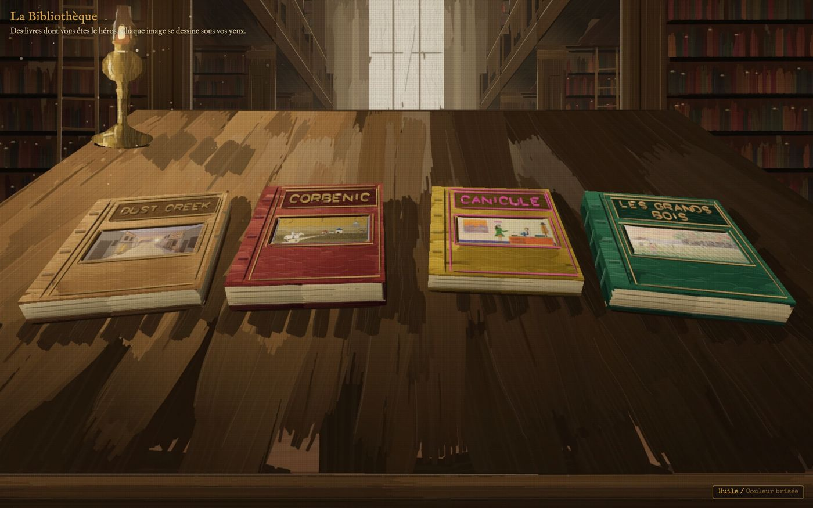
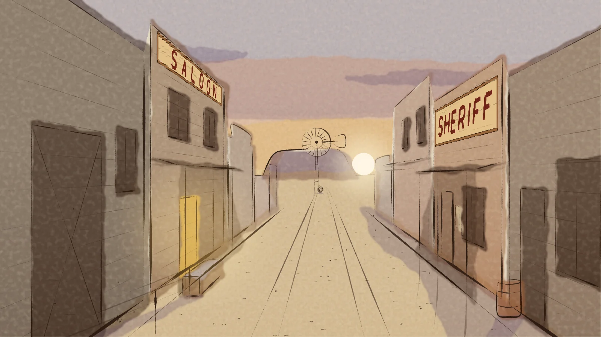
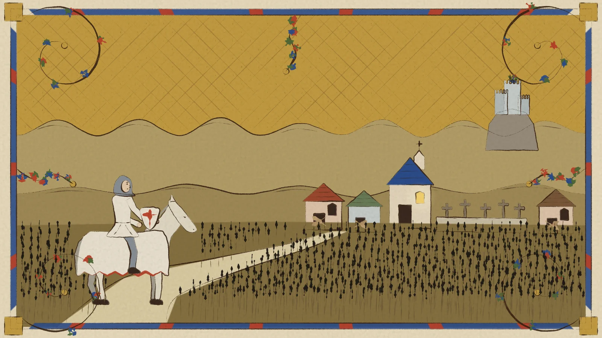
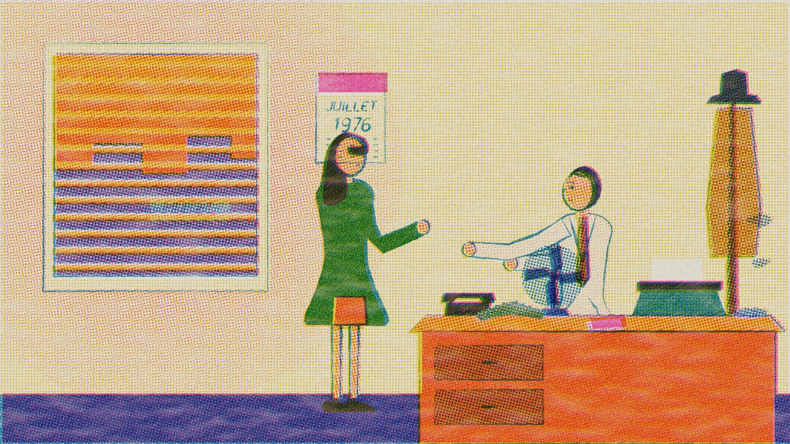
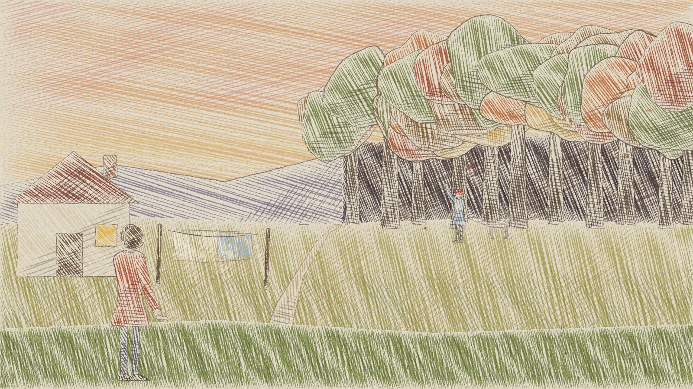
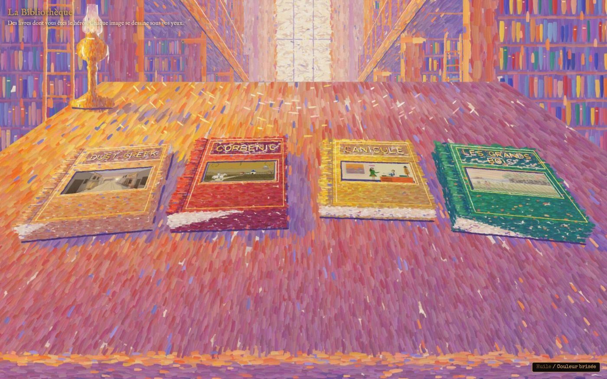
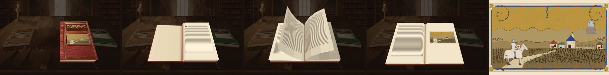
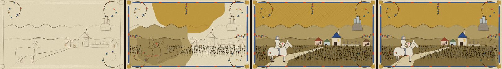

# La Bibliothèque

Four choose-your-own-adventure books, in French, where every picture is drawn in code and draws
itself in front of you, stroke by stroke, then keeps moving. You reach them through a painted
library: the camera travels down a long room of books to a reading table, you pick a book, it opens,
its pages riffle, and you dive into its first picture.

**Play it: <https://arimet.github.io/la-bibliotheque/>**



No image files are drawn by hand or generated by an image model. Every picture is TypeScript that
lays pen strokes, washes, hatching, ink drums or brush marks on a `<canvas>`, with the art core of
[anidoodle](https://github.com/alexgreensh/anidoodle).

## The books

| | Book | What happens | Drawn as |
|---|---|---|---|
|  | **Dust Creek** | 1881: a western town whose sheriff has vanished, until a ship falls on the mesa. | Pen and line-wash on warm paper, turning to cyanotype when the science fiction arrives. |
|  | **Corbenic** | A knight of the Round Table seeks the Grail in a valley where the dead do not stay down. Arthur has turned. | A medieval illumination that rots: iron-gall ink, lapis and gold leaf on vellum, the border going from ivy to thorns to bone. |
|  | **Canicule** | Paris, July 1976: a detective looks for a singer who vanished, and too many people are looking with him. | A Risograph print: three ink drums, halftone screens, registration slips. |
|  | **Les Grands Bois** | One evening your little brother followed a white fox into the forest. | Coloured pencil on toothed paper: layered hatching, paper left bare for the light. |

Each book has twelve pages and three endings. What you pick up on the way goes into a satchel, and
some choices need an item: a card you cannot play is shown greyed out, naming what you lack. Each
choice card carries a small version of the page it leads to. Every book has a gallery of all its
scenes (`#galerie`).

## The front page

The library is painted after the Long Room of Trinity College Dublin, in two styles you can switch
between: **oil on canvas** (Chardin's palette, bristle strokes, impasto) and **broken colour** (unmixed
dabs side by side, no black).



- **The journey.** The room is a set of painted cards (the far window, the bays with their stacks,
  ladders and busts, the table) placed at depths down the nave, like the wings of a toy theatre. The
  camera travels between them, and each card is scaled by its distance, so the room recedes.
- **The books** are real links laid over their painted selves. A click lifts the book off the table
  (its place stays empty), opens it with its thickness in CSS 3D, riffles eight soft pages, and
  zooms into the first picture. The book's reader then takes over on that same picture, already
  drawn (`?from=library`), with a view transition so no dark frame shows in between.
- The journey plays once; after that the page opens at the table. « Passer » skips it,
  « Revoir le voyage » plays it again. With reduced motion, the page opens at the table and a click
  goes straight to the book. If the pictures cannot load, or JavaScript is off, the four books are a
  plain list of links.



## How the pictures are made

### A picture is a film

Every picture is an anidoodle **film**: 1600×900 at 30 fps, with two shots.

1. **`draw`** (about 3.5 s): the picture makes itself, mark by mark, in the order a hand would make
   them: the contours, then the colour back to front.
2. **`loop`**: a seamless cycle that the reader repeats forever. It is what moves in the picture: a
   tumbleweed, a flame, a fan, falling leaves, a riffling curtain. Every motion completes a whole
   number of cycles per loop, and anything that travels leaves the frame before it wraps.



The contract of the art core (`src/canvas-core/core.ts`) makes a frame a pure function:
`draw(ctx, frame, env)` depends only on the frame number and the environment.

- **Randomness** only through `rng(seed)`. No `Math.random`, no clock, no `ctx.filter`.
- **Textures** (paper tooth, linen weave, grain) are seeded, tileable noise, composited per layer.
- **Wobble** and wet edges are baked into the geometry, never applied as filters.
- A frame renders the same pixels whatever order the frames are asked in, so a page can be scrubbed,
  exported or started half-way.

### A page is data

A page file (`src/canvas-core/p01.ts`, `c05.ts`, `r09.ts`, `f07.ts`…) describes its picture as data:
shapes, strokes, washes or hatch layers, and one `anim` function for what moves. It starts with a
comment that states the picture's one idea, its light and what moves. A **kit** per book turns that
data into the two shots:

| Kit | Book | What it does |
|---|---|---|
| `west.ts` | Dust Creek | Per-page perspective, pen strokes with nib, taper and pressure, washes painted onto cached surfaces, the sepia-to-cyanotype palette. |
| `manuscript.ts`, `border.ts`, `figures.ts` | Corbenic | Vellum, gold leaf with its glint, body colour that rots with a `rot` value from 0 to 1, a border that grows ivy then thorns then bones. Figures are flat, standing on ground lines, as in a real manuscript. |
| `press.ts` | Canicule | One layer per ink drum (yellow, fluorescent pink, blue; red for the last act), multiplied onto the paper through slightly-off registration. Tone is a halftone screen at one angle per ink; any colour is separated into the three drums. |
| `pencil.ts`, `beasts.ts` | Les Grands Bois | Each shape is filled with layers of parallel pencil strokes crossing each other on the shadow side; the pencil skips the valleys of the paper. Strokes that are finished are baked into a cached layer in fixed batches, so frames stay deterministic. Foxes, badgers, rabbits, deer, a heron, an owl. |
| `paintedOilKit.ts`, `brokenColourKit.ts`, `libraryScene.ts` | The library | Bristle strokes with ridges and impasto; unmixed dabs sampled from a colour field; the room's geometry, shared by both styles. |

What moves is drawn live on top of a cached, finished plate, so the loop only pays for the moving
parts. Hatching for moving shapes is worked out once and replayed; clip masks only include the shapes
that actually overlap a mark. Every page runs at about 60 fps in the reader, on desktop and phone.

### The library's cards are baked

Painting the whole room in oil takes seconds of CPU and would exceed the canvas size iOS allows.
So `npm run library` renders each card of each style once, in headless Chromium, into a WebP image
in `www/library/<oil|broken>/`. The front page loads those images (under 1 MB for oil, about 2 MB
for broken colour) and composites the journey with the same projection as the films.

### Checks

- `tools/gate.mjs` renders a film forwards and backwards and compares every frame, scans the code for
  forbidden calls, looks for dead air after the loop, and measures an MP4.
- `test/story.test.ts` walks every path of every book with its satchel: every choice leads to a
  page that exists, every page and every ending can be reached, and no reader is ever left without a
  card to play.
- `test/longroom.test.ts` checks the camera; `test/library-bake.test.ts` checks that the baked
  images still match the room's geometry.

## Generate a picture with a prompt

anidoodle is also a skill for AI coding agents such as Claude Code: with it installed, you describe a
picture and the agent writes the page's code, renders stills, looks at them and iterates. The kits
of this repository are what keeps a new picture in the style of its book. A prompt that works, here to redraw an existing page:

```text
With the anidoodle skill, redraw the picture of page 11 of Canicule, « Le Train de nuit »,
in src/canvas-core/r11.ts (its tool host is src/hosts/page-r11.ts).

The picture: the Gare du Nord at dawn, seen from the platform. The 5:48 to Brussels is leaving;
Lili stands at a carriage window, a pink headscarf, her hand flat on the glass. On the platform,
from behind, the detective in shirtsleeves, his jacket over his arm.
One idea: she is leaving and he lets her go.
Light: low sun through the glass roof, long shadows of the iron ribs across the platform.
What moves: the train sliding out (it leaves the frame before the loop wraps), steam, a pigeon.

Style: Canicule's Risograph press, src/canvas-core/press.ts. Read press.ts and r01.ts first and
follow them: three drums, knockouts, halftone, registration.
Contract: a film of 1600×900 at 30 fps with two shots, `draw` (the sheet prints itself, pass by
pass) and `loop` (180 frames, seamless, whole cycles only). Randomness only through rng(seed).

Before any animation, render the still with
node tools/still.mjs r11 --shot loop --out out/r11.png, look at it and show it to me.
Then animate, and check with node tools/gate.mjs r11. It must run at 60 fps in the reader.
```

What makes a prompt like this work:

- **One idea, one light, what moves.** Every page file starts with these three; the agent draws better
  from a scene than from a list of objects.
- **Name the kit and a page to follow.** The style lives in the kit; an existing page shows how the kit
  is used.
- **Ask for the still first.** A picture that is wrong is cheap to fix before it moves.
- **State the contract.** Two shots, whole cycles, `rng(seed)`: the gate enforces them anyway.
- **Keep the text and the picture in step.** The page's text (`src/stories/canicule.ts`) and its
  picture must say the same thing: who is there, what they wear, what the weather is.

## Run it

Node 24 or later (the tests run TypeScript directly).

```bash
npm install
npm run dev          # http://localhost:5180: the library, then /dust-creek/, /corbenic/, /canicule/, /grands-bois/
npm test             # every path of every book, the camera, the baked images
npm run typecheck
npm run build        # the bundles, into www/
```

Drawing tools (they need `playwright-core` and a Chromium: `npx playwright-core install chromium`):

```bash
node tools/still.mjs c05 --shot loop --out out/c05.png     # one frame of a page, to look at
node tools/render.mjs c05                                  # the whole film to MP4 (needs ffmpeg)
node tools/gate.mjs c05 --mp4 out/c05.mp4                  # determinism and contract checks
npm run covers       # each book's first picture, for the covers (needs sips on macOS, and cwebp)
npm run library      # bake the library's cards to WebP (needs cwebp)
```

The site is static: `www/` is what gets published. `.github/workflows/pages.yml` builds it and
deploys it to GitHub Pages on every push to `main`.

## Layout

| Path | What it is |
|---|---|
| `src/stories/` | the text of each book: pages, choices, items, endings |
| `src/canvas-core/` | the art core (`core.ts`, `film.ts`), the kits, and one file per picture: `pNN` Dust Creek, `cNN` Corbenic, `rNN` Canicule, `fNN` Les Grands Bois, `library*` the front page |
| `src/app/` | the reader (`reader.ts`, `player.ts`, `gallery.ts`), one entry per book, and the front page (`library.ts`) |
| `src/hosts/` | one small page per film, used by the tools |
| `tools/` | anidoodle's still, render and gate tools, and the library's bake |
| `www/` | the site: the front page, one folder per book, covers and baked cards |
| `docs/` | the design of each book and of the library |

## Credits

The art core in `src/canvas-core/core.ts`, the Risograph, oil and broken-colour kits and the tools in
`tools/` come from [anidoodle](https://github.com/alexgreensh/anidoodle) by Alex Greenshpun, under the
Apache License 2.0 (see `LICENSE-anidoodle` and `NOTICE`). Fonts from Google Fonts.
